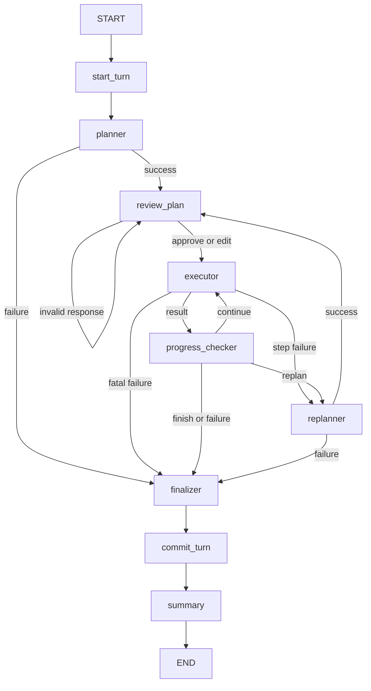

# Python Agent → LangGraph Agent 검증 패키지

원본 Python Agent의 계획·실행·재계획 로직을 9개 LangGraph 노드로 옮긴 실행 예제입니다.
기존 `planning_agent.py`를 별도로 가져올 필요 없이 이 폴더 안의 파일로 실행합니다.
주석과 설명은 한국어, 시스템 프롬프트와 도구 설명은 영어입니다.

## 1. 파일 구성

실행용 Python 파일은 **8개**, 자동 검증용 Python 파일은 **1개**입니다.

| 파일 | 역할 |
| --- | --- |
| `config.py` | 환경 변수, 서버·모델 설정, 실행 예산·검색 임계값 |
| `agent_state.py` | State 타입·초기값, 단계와 의존성·근거 조회 |
| `tools.py` | 도구 스키마, 문서 검색, 장기 기억 검색·저장, 임베딩 |
| `context.py` | LLM 단계별 context, 영어 시스템 프롬프트 |
| `llm.py` | 클라이언트 생성, 호출, JSON 검증·재시도, 호출 횟수 |
| `agent_nodes.py` | 9개 노드, 실행 보조 함수, 다음 노드 분기 판정 |
| `agent_graph.py` | 노드 등록, Edge 연결, checkpoint를 사용하는 Graph 생성 |
| `main.py` | 사용자 입력, 계획 검토, 재시도, State·trace 저장 |
| `tests/test_agent.py` | 실제 서버 없이 수행하는 자동 검증 |
| `data/documents.json` | 원본의 예제 문서 6개 |
| `.env.example` | 서버 설정 예시 |
| `requirements.txt` | 직접 의존하는 패키지의 고정 버전 |
| `VERIFICATION.txt` | 배포 ZIP에서 실행한 자동 검증 기록 |

주요 의존 방향은 `config → agent_state → context/llm → agent_nodes → agent_graph → main`입니다.
`tools`는 `config`를 읽고 실제 도구 함수를 제공하며, `main`이 Graph에 이를 연결합니다.
클라이언트·모델 객체·도구 함수는 `partial`로 연결하고 State에는 넣지 않습니다.

## 2. 설치

Python **3.11 이상**을 사용하세요. 배포 전 자동 검증 환경은 Python 3.12입니다.
ZIP을 풀고 `langgraph_agent` 폴더에서 다음 명령을 실행합니다.

```bash
python -m venv .venv
```

Windows PowerShell:

```powershell
.venv\Scripts\Activate.ps1
python -m pip install -r requirements.txt
Copy-Item .env.example .env
```

macOS/Linux:

```bash
source .venv/bin/activate
python -m pip install -r requirements.txt
cp .env.example .env
```

`sentence-transformers`는 PyTorch 등의 의존성을 함께 설치합니다.
자동 검증에서는 임베딩을 모의 값으로 대체하므로 임베딩 모델을 다운로드하지 않습니다.
실제 문서·기억 검색을 처음 실행하면 `Qwen/Qwen3-Embedding-0.6B`를 불러옵니다.

## 3. 서버 없이 자동 검증

```bash
python -m unittest discover -s tests -v
```

검증 내용:

- State 부분 update와 입력 객체 보존
- 계획 승인·수정, 잘못된 응답의 재검토
- Executor의 tool-calling 메시지와 근거 저장·출처
- Checker의 계속 실행, 종료, 재계획
- 재계획 후 사용자 검토, 완료 결과와 의존성 보존
- 계획 JSON 오류·실행 예산 소진 시 최종 실패 응답
- 동일 질문을 포함한 여러 turn, 중복 Commit 방지
- 이전 turn 요약과 Finalizer/Summary 오류 후 해당 노드 재시도
- 실제 도구의 문서 상태 필터·임계값, 기억 중복 제거·갱신·파일 저장
- OpenAI SDK와 모의 HTTP 응답을 이용한 thinking 설정 전달
- CLI의 계획 파일 편집, State·trace JSON 저장

테스트는 서버 호출과 임베딩 모델 다운로드를 수행하지 않습니다.
기억 파일 테스트는 임시 디렉터리를 사용합니다.
실제 모델 서버의 응답 품질과 실제 임베딩 모델 로드는 아래의 직접 실행으로 확인하세요.

## 4. 실제 모델 설정과 실행

`.env`에서 서버 주소와 API 키를 확인합니다.

```dotenv
OPENAI_BASE_URL=https://agent.kau.ac.kr/v1
OPENAI_API_KEY=your-api-key
MODEL_NAME=
ENABLE_THINKING=false
```

- `MODEL_NAME`을 비워 두면 서버의 `/models` 응답에서 첫 모델을 사용합니다.
  모델 ID를 알고 있으면 서버에 등록된 정확한 이름을 입력하세요.
- `KAU_API_KEY`가 환경에 있으면 `OPENAI_API_KEY`보다 우선합니다.
- 모든 LLM 요청에 Qwen/vLLM의 `chat_template_kwargs.enable_thinking` 설정을 전달합니다.
- `REQUEST_TIMEOUT`, 문서·기억 경로와 임베딩 모델도 `.env`에서 설정할 수 있습니다.
- 실행·검색 기준값은 `config.py`에서 관리합니다.

```bash
python main.py
```

질문 한 건을 처리한 뒤 종료하려면:

```bash
python main.py --question "2026년 해외 출장의 숙박비와 식비 한도, 출발 전 승인 요건을 근거와 함께 정리해줘."
```

context 출력이 필요하면:

```bash
python main.py --debug
```

대화 종료 명령은 `/quit`입니다. 같은 프로세스에서 Graph와 `thread_id`를 재사용합니다.
다른 ID를 사용하려면 `--thread-id session_2`를 지정하세요.

## 5. 계획 승인과 수정

최초 계획과 재계획 뒤에 `[계획 검토]`가 표시됩니다.

- Enter 또는 `approve`: 표시된 계획 승인
- `edit`: 수정할 pending 단계 전체가 담긴 JSON 파일 생성
- `quit`: 대화 종료

`edit`를 선택하면 출력된 경로의 JSON 파일을 편집기에서 열어 수정합니다.
저장한 뒤 터미널에서 Enter를 누르면 수정안을 Graph에 제출합니다.

```json
[
  {"id": 1, "task": "Find the active lodging limit and its source.", "depends_on": []},
  {"id": 2, "task": "Compare the findings from step 1.", "depends_on": [1]}
]
```

위 예시의 ID는 실제 표시된 계획의 ID에 맞춰 사용하세요.
수정안에는 앞으로 실행할 pending 단계 전체를 포함합니다.
완료·실패·대체 이력은 편집하지 않으며, 새 단계의 ID는 이력의 최대 ID보다 커야 합니다.
의존성은 완료된 단계 또는 앞선 수정 단계의 ID만 참조합니다.
삭제된 pending 단계는 `replaced` 이력으로 남습니다.
잘못된 수정안은 오류와 함께 다시 검토하도록 중단됩니다.

## 6. 직접 확인할 예제

### 문서 검색

질문: `2026년 해외 출장의 숙박비와 식비 한도, 출발 전 승인 요건을 근거와 함께 정리해줘.`

예제 문서에 근거한 확인 항목:

| 항목 | 예제 문서 내용 |
| --- | --- |
| 현행 숙박비 | 1박 220달러, `travel_lodging_B.txt`, 2026, active |
| 과거 숙박비 | 1박 180달러, `travel_lodging_A.txt`, 2024, retired |
| 식비 | 하루 60달러, `meal_expense.txt`, 2026, active |
| 승인 | 출발 전에 부서장 승인, `travel_request.txt`, 2026, active |

답변 문장과 계획은 모델에 따라 달라질 수 있습니다.
문서의 현행/과거 상태와 출처가 답변에 올바르게 반영되는지 확인하세요.

### 장기 기억

첫 질문 예시: `앞으로 출장 관련 답변은 한국어로 간단히 정리해줘. 이 선호를 기억해줘.`

도구 실행 뒤 `data/memory_store.json`에서 저장 여부를 확인할 수 있습니다.
다음 질문에서 필요한 경우 `search_memory`를 통해 해당 선호를 조회하는지 확인하세요.

### 다중 turn과 요약

같은 프로세스에서 세 번 이상 대화합니다.
`turns`가 증가하고, 최근 2개 turn 이전의 대화가 `summary`에 반영되는지 확인하세요.

## 7. 결과 파일과 실패 시 재시도

기본 `thread_id=session_1`이면 다음 파일이 생성됩니다.

- `outputs/state_session_1.json`: 최신 전체 State
- `outputs/trace_session_1.json`: 최신 turn의 실행 trace
- `outputs/plan_review_*.json`: 사용자가 선택한 계획 수정용 파일

같은 thread의 State·trace 파일은 최신 내용으로 갱신됩니다.
통신 등 실행 오류가 발생하면 현재 결과를 저장하고 `retry`/`quit` 입력을 받습니다.
`retry`는 같은 checkpoint에서 `graph.invoke(None, config)`를 호출합니다.
Summary 오류 뒤 재시도하면 이미 저장한 turn을 중복 Commit하지 않습니다.

State에서 특히 확인할 항목:

- `turn_status`: 정상 완료는 completed, 처리된 실패는 failed
- `turns`: 실제 사용자 입력과 최종 assistant 응답만 저장
- `task_state.plan`: 완료·대체 이력을 포함한 단계와 실행 결과
- `task_state.retrieved_documents`, `retrieved_memories`: 근거와 출처 단계 ID
- `task_state.plan_revision`, `replan_count`: 사용자 수정과 모델 재계획의 구분
- `task_state.trace`, `aborted_reason`: 실행 순서와 실패 원인

## 8. State와 실행 단위

- 메시지는 OpenAI 형식의 `dict`이며, State 갱신은 기본 overwrite를 사용합니다.
- Executor에는 현재 단계, 선언된 의존 결과, 관련 근거만 전달합니다.
- 모델 재계획은 완료 이력을 보존하고 미완료 단계를 새 ID로 교체합니다.
- `llm_call_count`는 Planner·Executor·Checker·Replanner 호출과 JSON 재시도를 셉니다.
  Finalizer·Summary 호출은 원본 정책대로 실행 예산에서 제외합니다.
- Node가 예외로 종료되면 그 노드의 부분 update가 저장되지 않으므로,
  전송 실패와 재시도 시 실제 HTTP 요청 수와 저장된 호출 횟수가 다를 수 있습니다.
- checkpoint 재시도 단위는 노드입니다. Executor 재시도는 해당 단계의 도구 호출도 반복할 수 있습니다.

기본 Graph checkpoint는 `InMemorySaver`이므로 프로세스를 종료하면 사라집니다.
장기 기억은 별도 JSON 파일에 남습니다.
내보낸 State JSON은 검증 자료이며 프로세스 재시작 시 실행 위치를 자동 복원하는 기능은 포함하지 않습니다.

## 9. Graph 흐름


