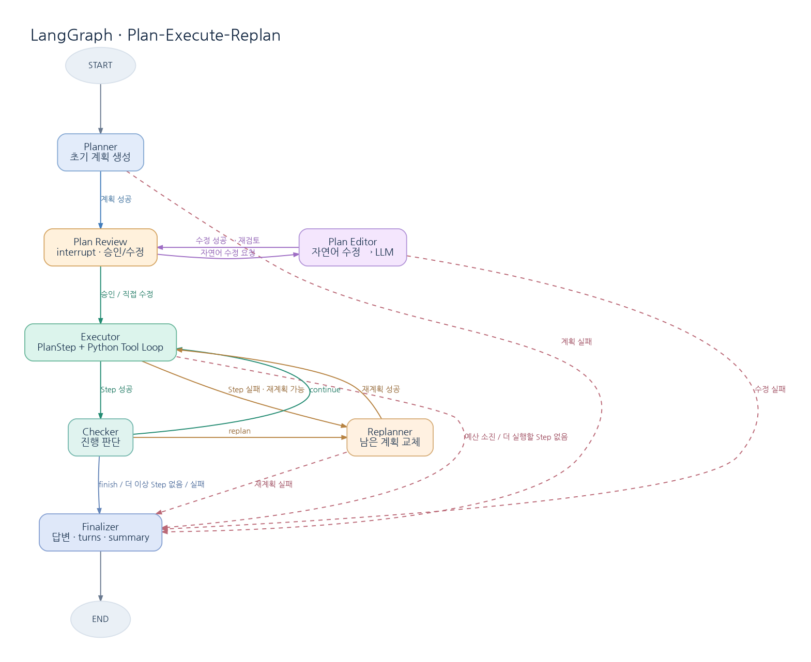

# Python Agent → LangGraph

6주차 Python Agent의 계획·Tool 실행·진행 판단·재계획 기능을 유지하면서, `run_turn()`의 실행 흐름을 LangGraph로 전환했다. Executor 내부의 Tool Calling 반복은 기존 Python 코드를 사용한다.

## 주요 파일 구조

```text
app/
├── agent/
│   ├── core/
│   │   ├── graph.py          # LangGraph로 에이전트 그래프 구성
│   │   ├── state.py          # PlanStep, TaskState, AgentState     ()
│   │   ├── contexts.py       # Node별 LLM Context 구성             (기존 contexts.py 와 동일)
│   │   └── llm.py            # LLM 클라이언트
│   ├── plan/
│   │   ├── planner.py        # 계획 생성           (기존 agent_loop.py 에서 코드를 가져와서 분리함)
│   │   ├── executor.py       # 단계 실행 및 Tool Calling Loop (기존 agent_loop.py 에서 코드를 가져와서 분리함)
│   │   ├── checker.py        # 진행 판단           (기존 agent_loop.py 에서 코드를 가져와서 분리함)
│   │   ├── replanner.py      # 남은 계획 수정      (기존 agent_loop.py 에서 코드를 가져와서 분리함)
│   │   └── common.py         # 공통 함수           (기존 agent_loop.py 에서 코드를 가져와서 분리함)
│   └── tools.py             # 문서·Memory 검색 및 Tool 실행     (기존 tools.py 에서 외부 document를 불러오도록 수정함)
├── data/documents.json      # 테스트용 문서
├── images/agent_graph.png   # Node 그래프 이미지
├── test_langgraph_agent.ipynb # 테스트용 노트북 파일
├── requirements.txt            # 필요한 모듈들
└── README.md                   # 지금 보는 파일임
```

## 실행 방법

프로젝트의 루트 디렉터리에서 실행한다. (테스트는 python 3.12.9 에서 함)

```powershell
pip install -r requirements.txt
```

`.env` 파일에 `KAU_API_KEY`, `OPENAI_BASE_URL`, `MODEL_NAME`을 지정한다.

`data/documents.json` 경로에 문서를 준비한다. (기존 tools.py 에 문서가 들어있어서 따로 준비 안해도 실행 가능)
또는 `DOCUMENTS_FILE = data/documents.json` 부분을 수정하고 원하는 경로에 문서를 배치한다.

### 테스트 코드
```powershell
python -m agent.core.graph
```
question = (
        "2026년 해외 출장의 숙박비와 식비 한도, 그리고 출발 전 승인 요건을 "
        "근거 문서와 함께 정리해줘."
    )
로 에이전트가 실행됨

계획이 출력되면 Enter로 승인하거나 자연어로 수정 요청을 입력한다.

### test_langgraph_agent.ipynb 실행
* 제출용 테스트는 `test_langgraph_agent.ipynb`를 열어서 초기화, 공통 출력·실행 헬퍼 부분을 실행한다.
* 1.도구 능력 밖의 질문, 2.정상 과제 부분을 실행하고 결과를 확인한다.
* 3.checkpoint검증을 통해 Checkpointer와 thread_id를 사용하여 중단 후 재개를 테스트 한다.
* 4.계획 수정 테스트를 통해 자연어로 요청한 계획 수정이 이루어 졌는지 확인한다.
* 5.summary 테스트를 통해 3턴 이후 summary가 생성되는지 확인한다.
* 6.최종 점검으로 모든 요구사항을 만족하는지 확인한다.

## 구현 설명

### 1. Plan Review 및 인터럽트 처리 방식

`planner`가 LLM으로 계획을 생성한 뒤, `plan_review`에서 `interrupt()`를 호출해 목표, 검토 질문, 각 단계의 `instruction`과 `depends_on`을 보여주고 멈춘다.

- 승인(Enter): `Command(resume={"approved": True})` → `executor` 실행
- 수정(자연어): `Command(resume={"approved": False, "feedback": "수정 요청"})` → `plan_editor`에서 LLM이 계획 재작성 → `plan_review`에서 재승인

### 테스트 예시
```
[계획 검토]
목표: 2026년 해외 출장의 숙박비와 식비 한도, 그리고 출발 전 승인 요건을 근거 문서와 함께 정리해줘.
질문: 이 계획을 승인하거나 수정할 내용을 입력하세요.
1. 검색: 2026 년 해외 출장 관련 정책 문서에서 숙박비와 식비의 한도 기준을 찾아라.
   depends_on: []
2. 검색: 2026 년 해외 출장 관련 정책 문서에서 출발 전 승인 요건 (사전 승인 절차, 필요한 서류 등) 을 찾아라.
   depends_on: []
3. 검색: 2026 년 해외 출장 관련 정책 문서에서 해당 한도와 승인 요건이 명시된 근거 문서 (문서 제목, 버전, 발행일) 를 찾아라.
   depends_on: []
4. 추론: 검색된 숙박비/식비 한도, 승인 요건, 그리고 근거 문서 정보를 종합하여 정리하라.
   depends_on: [1, 2, 3]

승인= Enter, 수정= 피드백 입력: 3번은 없어도 됨. 1, 2 에서 검색된 문서를 그냥 이용하면 되니까.       

[계획 검토]
목표: 2026년 해외 출장의 숙박비와 식비 한도, 그리고 출발 전 승인 요건을 근거 문서와 함께 정리해줘.
질문: 이 계획을 승인하거나 수정할 내용을 입력하세요.
1. 검색: 2026 년 해외 출장 관련 정책 문서에서 숙박비와 식비의 한도 기준을 찾아라.
   depends_on: []
2. 검색: 2026 년 해외 출장 관련 정책 문서에서 출발 전 승인 요건 (사전 승인 절차, 필요한 서류 등) 을 찾아라.
   depends_on: []
3. 추론: 검색된 숙박비/식비 한도 및 출발 전 승인 요건 정보를 종합하여 정리해라.
   depends_on: [1, 2]
```
목표 '2026년 해외 출장의 숙박비와 식비 한도, 그리고 출발 전 승인 요건을 근거 문서와 함께 정리해줘.' 에 대한 에이전트의 초기 계획은 4단계 였지만 이렇게 실행할 경우 실제 문서 내용에 존재하지 않은 문서 번호, 제목, 발행일을 찾기 위해 불필요한 replan 이 실행된다. 
따라서 계획 수정 피드백 "3번은 없어도 됨. 1, 2 에서 검색된 문서를 그냥 이용하면 되니까." 을 통해 llm 이 수정한 계획을 생성하여 3번 스텝이 사라진 것을 확인 하였다.

재개 시 `plan_review` Node는 처음부터 다시 실행된다. 따라서 LLM을 호출하는 `planner`·`plan_editor`를 검토 Node와 분리했다. `InMemorySaver`와 동일한 `thread_id`를 사용해 중단된 State에서 재개한다.

### 2. Node와 노드 그래프



| Node | 역할 | 주요 다음 경로 |
|---|---|---|
| `planner` | 최초 계획 생성 | 성공 → `plan_review`, 실패 → `finalizer` |
| `plan_review` | 계획 승인·수정 요청 (`interrupt`) | 승인 → `executor`, 피드백 → `plan_editor` |
| `plan_editor` | 자연어 피드백을 반영해 계획 재작성 | 성공 → `plan_review`, 실패 → `finalizer` |
| `executor` | 현재 PlanStep 실행, 기존 Tool Loop 유지 | 성공 → `checker`, 실패 → `replanner` 또는 `finalizer` |
| `checker` | `continue` / `replan` / `finish` 판단 | `executor` / `replanner` / `finalizer` |
| `replanner` | 실행 중 남은 계획 교체 | 성공 → `executor`, 실패 → `finalizer` |
| `finalizer` | 최종 답변·대화 기록·Summary 갱신 | `END` |

일반 Edge는 `START → planner`, `finalizer → END`이다. 나머지는 State를 확인하는 Conditional Edge로 실행 경로를 결정한다. 사용자 피드백에 따른 `plan_editor`와 실행 중 자동 `replanner`는 서로 다른 기능이다.

`plan_editor`는 최초 에이전트가 생성한 계획을 사용자로부터 피드백을 받아서 규칙을 수정하는 것이고
`replanner`는 실행 중간에 에이전트가 계획을 수정하는 것이다.

### 3. State 설명

`agent/core/state.py`에 `TypedDict`로 정의했다. `PlanStep`은 개별 실행 단계, `TaskState`는 현재 작업, `AgentState`는 대화 전체와 현재 실행 상태를 나타낸다.

AgentState

| 필드 (자료형) | 역할 | 주로 갱신하는 Node |
|---|---|---|
| `turns` (`list[list[Message]]`) | 완료된 대화 기록 | `finalizer` |
| `summary` (`str`) | 이전 대화 요약 | `finalizer` |
| `current_turn` (`list[Message]`) | 현재 대화 입력·응답 | Turn 초기화, `finalizer` |
| `current_task` (`TaskState \| None`) | 계획과 근거 등 현재 작업 | `planner`, `plan_editor`, `executor`, `checker`, `replanner` |
| `review_feedback` (`str \| None`) | 자연어 계획 수정 요청 | `plan_review`, `plan_editor` |
| `step_result` (`StepResult \| None`) | 최근 단계 실행 결과 | `executor` |
| `progress` (`ProgressResult \| None`) | 다음 실행 방향과 근거 | `checker` |
| `final_response` (`str \| None`) | 최종 응답 | `finalizer` |
| `turn_status` (`TurnStatus`) | `idle / running / completed / failed` | `planner`, 실패 처리, `finalizer` |

TaskState (`current_task`)

| 필드 (자료형) | 역할 | 주로 갱신하는 Node |
|---|---|---|
| `goal` (`str`) | 사용자 요청 목표 | `planner` |
| `plan` (`list[PlanStep]`) | 작업 계획과 단계별 상태 | `planner`, `plan_editor`, `executor`, `checker`, `replanner` |
| `current_plan_step_id` (`int \| None`) | 현재 실행 단계 ID | `planner`, `plan_editor`, `checker`, `replanner` |
| `plan_revision` (`int`) | 계획 수정 버전 | `plan_editor`, `replanner` |
| `replan_count` (`int`) | 자동 재계획 횟수 | `replanner` |
| `retrieved_documents` (`dict`) | 검색 문서 및 근거 | `executor` 내부 Tool |
| `retrieved_memories` (`dict`) | 검색된 장기기억 | `executor` 내부 Tool |
| `llm_call_count` (`int`) | JSON LLM 호출 횟수·예산 | Planner·Checker·Replanner 등 |
| `aborted_reason` (`str \| None`) | 작업 실패 이유 | 실패 처리 Node |
| `trace` (`list[dict]`) | 실행·수정·분기 이벤트 | 각 Node·Tool |

PlanStep

| 필드 (자료형) | 역할 | 주로 갱신하는 Node |
|---|---|---|
| `id` (`int`) | 단계 식별자 | `planner`, `plan_editor`, `replanner` |
| `instruction` (`str`) | 실행할 작업 | `planner`, `plan_editor`, `replanner` |
| `depends_on` (`list[int]`) | 선행 단계 ID | `planner`, `plan_editor`, `replanner` |
| `status` (`PlanStepStatus`) | `pending / in_progress / completed / failed / replaced` | `executor`, `checker`, `replanner` |
| `result` (`str \| None`) | 단계 결과 | `executor` |
| `messages` (`list[Message]`) | 단계 내 LLM·Tool 기록 | `executor` |
| `document_ids` (`list[str]`) | 조회한 문서 ID | `executor` 내부 Tool |
| `memory_ids` (`list[str]`) | 조회한 Memory ID | `executor` 내부 Tool |

`StepResult`는 `status`(`completed / failed`)와 `content`(`str`), `ProgressResult`는 `decision`(`continue / replan / finish`)과 `reason`(`str`)을 가진다.

주요 읽기 관계는 `planner`(`current_turn`, `turns`, `summary`), `plan_review`(`current_task`), `plan_editor`(`current_task`, `review_feedback`), `executor`(`current_task`), `checker`(`current_task`, `step_result`), `replanner`(`current_task`, `progress`), `finalizer`(`current_task`, `turns`, `summary`)이다.

갱신·중단·재개: 각 Node는 입력 State를 직접 수정하지 않고 `deepcopy()`한 뒤 변경 필드만 반환한다. 기본적으로 overwrite를 사용하며, 중첩된 `current_task`는 기존 필드를 보존한 채 갱신한다. Checkpoint에는 현재 Turn, 계획·진행 위치, 완료된 결과·근거, 실행 예산 등이 저장된다. `thread_id`는 State 필드가 아니라 실행 `config`로 전달하며, `InMemorySaver`의 기록은 프로세스 종료 시 사라진다.
